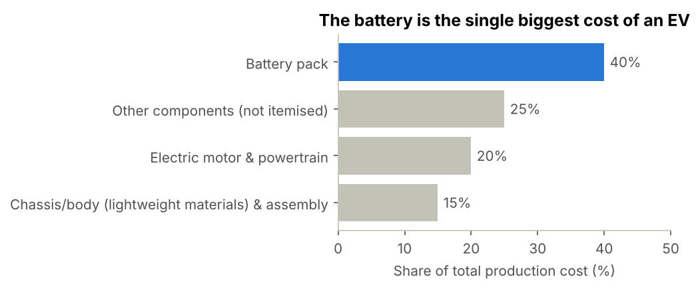
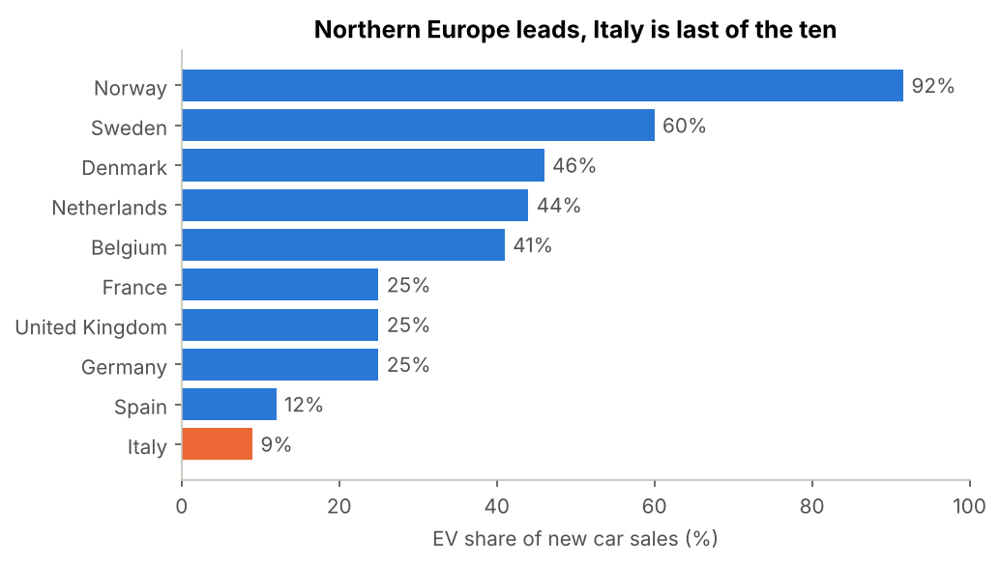
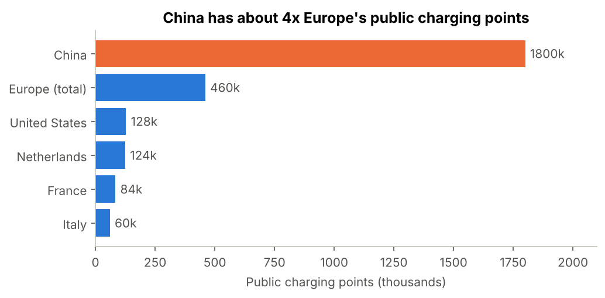
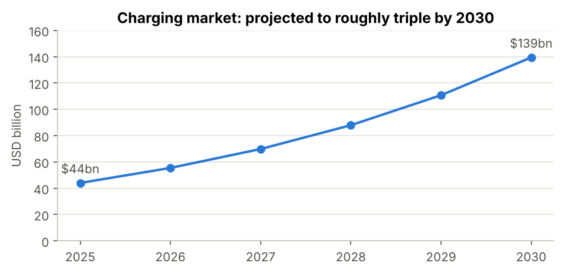

# The Economics of Electric Vehicles: Innovation, Supply Chain & Investment

Data-driven companion to my bachelor's thesis in Business Administration (Roma Tre University, Rome, 2025):
*"Viaggio nelle auto elettriche: una prospettiva economica su innovazione e investimenti"* ("A journey into electric vehicles: an economic perspective on innovation and investment").

I collected the key figures from the thesis into clean CSV datasets and analysed them in a Python notebook (pandas + matplotlib).

🇮🇹 [Versione italiana](README.it.md)

---

## Research questions

1. What drives the production cost of an electric vehicle (EV)?
2. How exposed is the EV industry to raw-material (lithium) volatility?
3. How fast are European countries adopting EVs, and why is Italy behind?
4. Is charging infrastructure keeping up, and is it an investment opportunity?
5. How large is China's lead in clean-tech investment?

## Key findings

| | Finding |
|---|---|
| 🔋 **Cost** | The battery accounts for about **40%** of an EV's production cost. Controlling the battery supply chain means controlling most of the cost. |
| ⛏️ **Raw materials** | Lithium fell **~84%** from its 2022 peak ($85k/t) to 2023 ($13.5k/t). China produces about **92%** of the world's batteries. |
| 🇪🇺 **Adoption** | EV share of new car sales in 2024: **91.6%** in Norway vs **9%** in Italy. |
| 🔌 **Infrastructure** | China has about **1.8 million** public charging points, roughly 4× Europe. Italy has about 5 EVs per public charger. |
| 📈 **Investment idea** | The charging-infrastructure market is projected to grow from **$44bn (2025)** to about **$139bn (2030)** at a 25.94% CAGR. |
| 🌏 **Investment gap** | 2018–2022: China invested **$329bn** in clean tech vs **$29bn** for Europe and the US combined (≈11×). |

<p align="center">
  
  
</p>
<p align="center">
  
  
</p>

## Repository structure

```
ev-economics-thesis/
├── README.md                 # this file (English)
├── README.it.md              # Italian version
├── data/                     # CSV datasets, each row with its source
├── notebooks/
│   └── ev_economics_analysis.ipynb   # analysis and charts
├── figures/                  # charts exported by the notebook
├── docs/
│   └── thesis_summary.md     # chapter-by-chapter summary of the thesis (English)
└── requirements.txt
```

## How to run

```bash
pip install -r requirements.txt
cd notebooks
jupyter notebook ev_economics_analysis.ipynb
```

You can also just open the notebook on GitHub: the charts are already rendered.

## Data and sources

All figures come from the sources cited in the thesis (industry associations such as ACEA, UNRAE and Motus-E, market data from BNEF, Bloomberg and GlobalData, and Italian and international press, 2024–2025). Every CSV row has a `source` column.

## Limitations

- Secondary data: figures come from published reports and articles, not from primary data collection.
- Reference periods differ between datasets (2022–2025), so cross-country comparisons are approximate.
- The 2030 market size is a mechanical projection of a published growth rate, not an independent forecast.

## Skills demonstrated

Market and industry analysis · supply chain perspective on raw materials · data collection and source tracking · Python (pandas, matplotlib) · data visualisation · reproducible analysis in Jupyter

## Author

**Mohamed Nasr**: M.Sc. student in Supply Chain Management, University of Cologne
[LinkedIn](https://www.linkedin.com/in/mohamednasr27)
